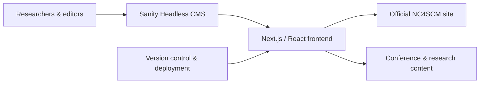

<!--
  Raazia Imran Reshamwala | GitHub profile README
  Original achievements and links preserved; research and institutional work added in November 2026.
  GitHub renders Markdown, HTML details, GIFs, SVGs and external image cards, but not arbitrary JavaScript.
-->

# Hi there! I'm Raazia Imran Reshamwala 👋

**Undergraduate Researcher** · **Software Engineer (Digital Infrastructure)** · **Woman in STEM**

[🔬 Research](#-research--publications) · [🏛️ National Centre](#-national-centre--research-infrastructure) · [🚀 Projects](#-explore-my-projects) · [🛠️ Skills](#-technical-toolbox) · [🏆 Recognition](#-recognition--community) · [📊 GitHub Activity](#-github-activity)

---

## 👩‍💻 A little about me

I'm a **third-year B.E. Software Engineering student at NED University of Engineering & Technology, Karachi**. My work connects **applied AI and research**, **real-world software systems**, and **technology that people can actually use**.

- 🔬 **Research:** co-author of a peer-reviewed *AI and Ethics* paper; working on benchmark-driven AI infrastructure feasibility within an HEC-funded sustainable data-centre project.
- 🏛️ **Institutional engineering:** develop and maintain the official digital platforms for NED's **National Center for Sustainable Construction Materials (NC4SCM)**, including its main website and conference portal.
- 🤖 **AI & automation:** explore LLM evaluation, data analysis, Python workflows, RAG concepts, and n8n automation.
- ♿ **Human-centred design:** create approachable learning tools, accessible interactions, and research/academic workflows.
- 🛰️ **Beyond the screen:** CanSat payload, sustainability-focused EvaCRATE work, and competition projects that combine software with physical systems.

> **What motivates me:** making complex technology more trustworthy, useful and accessible, while learning how to turn research into dependable software.

---

## 🔬 Research & publications

> 📄 **Peer-reviewed research · 2026**  
> **A Comprehensive Analysis of Security Risks and Productivity Impacts of AI-Generated Code**  
> S. Zardari, M. Osama, S. M. Ammar, **R. I. Reshamwala**, A. Siddiqui — *AI and Ethics* (Springer Nature).  
> Research on AI-assisted programming, software security and developer productivity.

**🧪 Research in progress — WISP-DC**  
**WISP-DC: A Benchmark-Trace-Based Feasibility Framework for Workload-Specific AI Infrastructure Planning**

- Investigates **constraint-aware GPU configuration selection** for AI training and inference, using published **MLPerf** records as evidence.
- Includes training time-to-quality, inference throughput and latency, reproducible Python evaluation, and explicit feasibility/infeasibility explanations.
- The documented evaluation includes **30 training logs**, **four inference configurations**, **24 evidence-supported automated checks**, and **99 inference sensitivity cases**.
- **Scope matters:** published benchmarks were replayed and analysed; the project does **not** claim locally training the evaluated models or measuring full data-centre energy consumption.

<b>🧩 Open the WISP-DC research method and scope</b>

 

| Stage | Research approach |
| --- | --- |
| **Workloads** | ResNet-50 training and Llama 2 70B server inference benchmarks |
| **Evidence** | MLPerf Training v4.0 and Inference v5.0 published results |
| **Decision method** | Validate inputs → filter hard constraints → rank feasible configurations → explain decisions |
| **Evaluation** | Source reconciliation, predefined cases, unit tests, sensitivity sweeps |
| **Boundaries** | No invented performance for untested systems; power and cost estimates only where supported |

**Research context:** This work sits within NED University's HEC-NRPU project *Design and Development of a Decision Support Tool for Energy Efficient and Sustainable Cooling Selection in Data Centers*, under PI **Dr. Syed Muhammad Sheraz** (HEC-NRPU-178875-71). WISP-DC studies the narrower infrastructure-feasibility component, not a fully validated cooling-selection system.

---

## 🏛️ National centre & research infrastructure

**Software Engineer (Digital Infrastructure) · NC4SCM, NED University · 2026–present**

I work on the centre's research-facing digital platforms, connecting **institutional content, academic profiles, conference information, and publication workflows** with practical tools for non-technical editors.

| Live platform | What it supports | My engineering focus |
| --- | --- | --- |
| [🏗️ **NC4SCM Official Website**](https://www.nc4scm.com/) | National-centre research, people, projects and institutional information | Next.js, React, TypeScript, Sanity headless CMS, content schemas, responsive UI, SEO and deployment |
| [🌱 **GCGC Conference Portal**](https://gcgc.nc4scm.com/) | Global Conference on Green Construction Materials and Practices | Research/conference information architecture, accessible UI, content management, deployment and maintenance |

<b>🗂️ See the architecture and repositories</b>

 

- [NC4SCM platform repository](https://github.com/Raazia-Imran/nc4scm-platform)
- [GCGC conference repository](https://github.com/Raazia-Imran/nc4scm-conference)
- [Live centre website](https://www.nc4scm.com/) · [Live conference portal](https://gcgc.nc4scm.com/)

*The diagram illustrates the content-driven architecture at a high level; the two sites have their own deployment and implementation details.*

---

## 🚀 Explore my projects

<b>🤖 AI, research & data systems</b>

 

| Project | What I worked on | Explore |
| --- | --- | --- |
| **WISP-DC** | Benchmark-trace-based, explainable AI infrastructure feasibility research | [Research & code](https://github.com/Raazia-Imran/WISP-DC) |
| **Bijli Gayi** | LLM constraint-following evaluation with Urdu–English code-switching and open-weight model inference | Research project |
| **O.R.B.I.T** 🏆 | Operational reporting and business intelligence, with Python and AI-assisted workflows; **Best Creative Award, Sentec Hackathon** | [Repository](https://github.com/Raazia-Imran/O.R.B.I.T) · [Demo](https://o-r-b-i-t.streamlit.app/) |
| **ClinixTech** | Hospital workflow system exploring data structures, patient triage and analytics | [Repository](https://github.com/Raazia-Imran/Clinixtech) · [Demo](https://clinixtech.onrender.com/) |

<b>🧩 Human-centred technology & academic tools</b>

 

| Project | What it does | Explore |
| --- | --- | --- |
| **Samajh** ♿ | An accessible digital-skills learning companion with guided simulations for everyday tools | [Repository](https://github.com/Raazia-Imran/Samajh) |
| **OBE-TraceX** 🎓 | Outcome-based education assessment and review portal; currently a **tested local pilot**, not a university-wide production release | [Repository](https://github.com/Raazia-Imran/OBE-TraceX) |
| **KitabiBuddy** 📚 | Digital book-discovery and library concept; selected for **NIC Karachi Pitch Cohort 14** | Project showcase |

<b>🌐 Websites, CMS & production engineering</b>

 

| Project | Contribution | Explore |
| --- | --- | --- |
| **NC4SCM** | National research centre website, CMS and digital operations | [Live](https://www.nc4scm.com/) · [Code](https://github.com/Raazia-Imran/nc4scm-platform) |
| **GCGC 2027** | Conference portal and content workflow | [Live](https://gcgc.nc4scm.com/) · [Code](https://github.com/Raazia-Imran/nc4scm-conference) |
| **RS International / Studio X** | Corporate web platform; previous web developer internship | [Live](https://rsi-studio-v2.vercel.app/) |
| **BlueNet+** | Maritime platform; previous web developer internship | [Project](https://blue-net-plus-8iyh2tgxz-raazias-projects-142c0b42.vercel.app) |
| **HosH** | Client-facing website, production deployment, SEO, and form workflows | [Website](https://hoshintegrity.com/) · [Code](https://github.com/Raazia-Imran/HosH) |

<b>🛰️ Sustainability, hardware & space</b>

 

| Project | Focus | Explore |
| --- | --- | --- |
| **EvaCRATE** 🌍 | IFTP 2026 finalist sustainability concept: zero-electricity storage with a digital/IoT direction | [Website project](https://github.com/Raazia-Imran/evaCRATE) |
| **CanSat Explorer (CK-2508)** 🛰️ | Aerospace payload work with sensors, telemetry and a Python ground station | Hardware project |
| **NASA Earth Information Jukebox / Monsoon Listener** 🌧️ | Accessible Earth-data sonification; repository currently represents a **project foundation/scaffold** | [Repository](https://github.com/Raazia-Imran/nasaAPP) |

---

## 🛠️ Technical toolbox

**Languages, research & data**

**Web, CMS & cloud**

**Additional research and workflow tools**

<b>🔍 How I use these skills</b>

 

- **Research:** literature review, benchmark-trace analysis, Python data cleaning and experiments, algorithmic reasoning, LaTeX writing.
- **AI:** LLM evaluation, prompt design, NLP experimentation and AI-assisted workflows; exploring RAG and multi-agent systems.
- **Full stack:** Next.js, TypeScript, REST APIs, backend integration, authentication, responsive interfaces and CMS schemas.
- **Shipping:** Git/GitHub, Vercel, Cloudflare Pages, SEO, Google Search Console, DNS configuration, deployment checks and ongoing maintenance.
- **Design:** accessibility-aware interface design, Figma and user-focused digital experiences.

---

## 🏆 Recognition & community

| Area | Milestone |
| --- | --- |
| 🏅 **Research** | Co-authored peer-reviewed research in *AI and Ethics* (2026) |
| 🌍 **Sustainability innovation** | IFTP '26 Global Finalist (Texas A&M) for EvaCRATE |
| 🥇 **Competitive programming** | ICPC Asia Topi Regional Contest 2025 — **National Top 104** |
| 🏆 **Hackathons** | Best Creative Award at Sentec; first-place Devpost Student Stress Management System project |
| 🛰️ **Aerospace** | Built and launched the CanSat Explorer (CK-2508) payload with a team at SUPARCO |
| ⭐ **Community** | Star Volunteer Shield for CodeSphere 2.0 graphics/promotions (350+ attendees); Class Representative |
| 📖 **University recognition** | Featured in NED University's annual book for technical achievements |
| 🎓 **Learning & fellowships** | Stanford Code in Place 2026; Aspire Leaders Program (2025); OMLAS-NELIS Asia Fellow (2025); Google AI Professional Certificate; Google UX Design Professional Certificate |

---

## 🌱 Learning, beyond the code

<table>
<tr>
<th align="center">Technical exploration</th>
<th align="center">Personal growth</th>
</tr>
<tr>
<td>🤖 Multi-agent LLMs, AI safety & evaluation ⚡ Systems design and sustainable computing 🧠 Advanced DSA / ICPC preparation ♿ Accessible and human-centred computing</td>
<td>🇯🇵 Japanese: Hiragana / Katakana 🇸🇦 Arabic: basic conversation 📚 Reading and continuous learning 🌱 Community and mentorship</td>
</tr>
</table>

---

## 📊 GitHub activity

<b>🐍 Open my animated contribution garden</b>

 

<picture>
  <source media="(prefers-color-scheme: dark)" srcset="https://raw.githubusercontent.com/Raazia-Imran/Raazia-Imran/output/github-snake-dark.svg" />
  <source media="(prefers-color-scheme: light)" srcset="https://raw.githubusercontent.com/Raazia-Imran/Raazia-Imran/output/github-snake.svg" />
  
</picture>

This graphic is generated by [GitHub Actions](https://github.com/Raazia-Imran/Raazia-Imran/actions/workflows/snake.yml), based on GitHub's contribution grid. If it is missing, run the workflow once from the **Actions** tab.

---

### 💌 Let's build something that matters

*Interested in trustworthy AI, research software, sustainable systems or accessible technology? I'd love to connect.*

**Thanks for visiting! 🌸**

